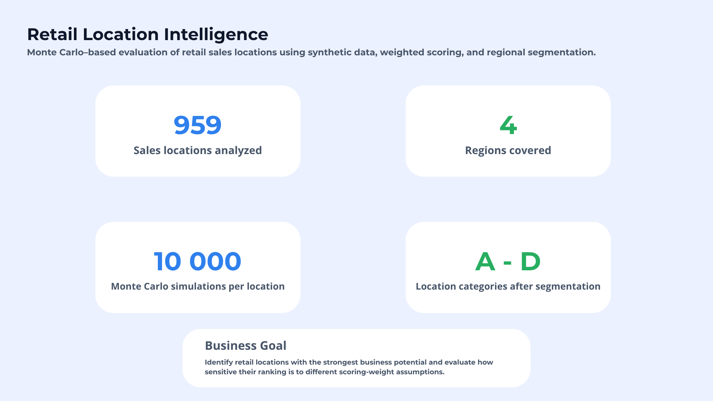
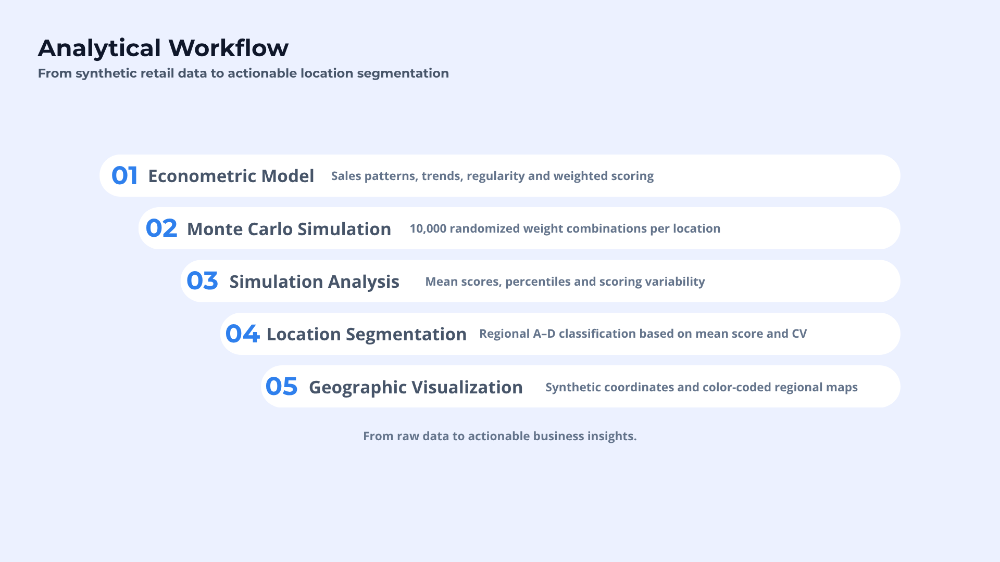
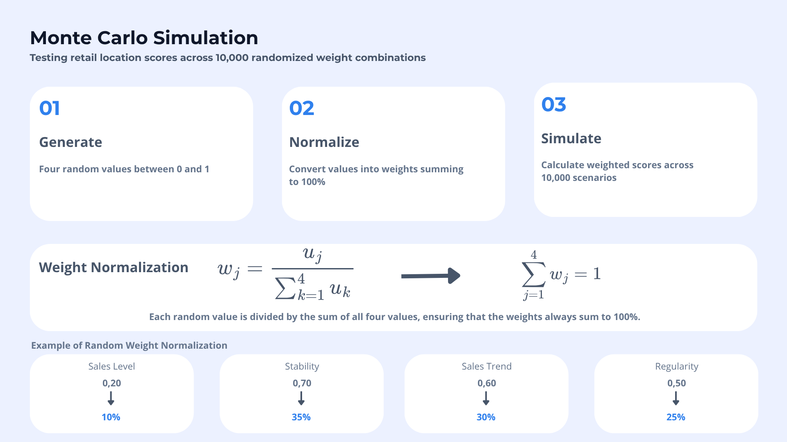
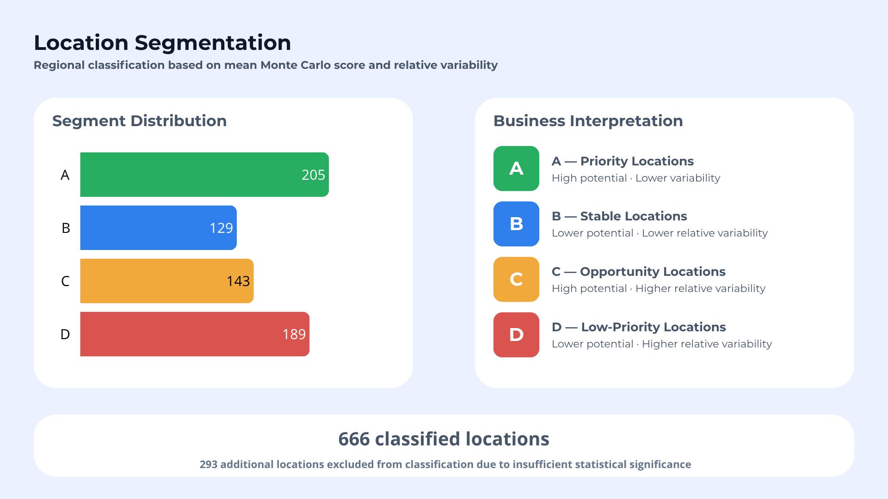
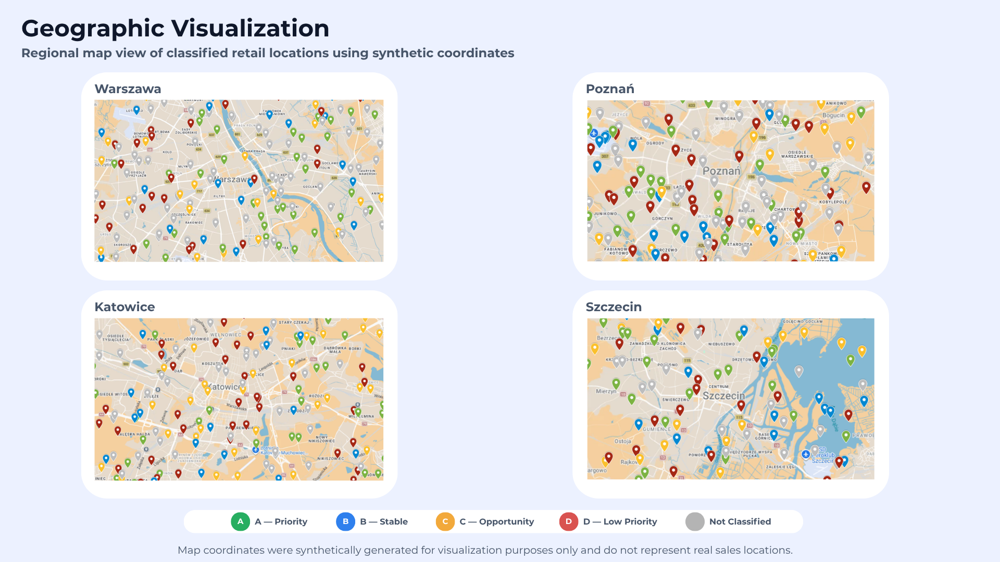

# Retail Location Intelligence — Monte Carlo Simulation

**Multi-criteria retail-location scoring, Monte Carlo weight sensitivity analysis, and regional segmentation in Microsoft Excel.**

> **Portfolio / demonstration project.** The published dataset and map coordinates are synthetic. Geographic coordinates are used **only for visualization**, not as explanatory variables or inputs to the scoring model. This project is an analytical decision-support example, **not** a validated sales forecast or a recommendation for real-world site investments.

**[Polska wersja README](README_PL.md)**



## Business question

How can we prioritize retail sales locations when the importance assigned to sales performance, stability, trend, and regularity is subjective?

Rather than present a single weighting scheme as objectively correct, the project evaluates **how sensitive a location's score is to alternative weight combinations**. It then translates the simulation results into four easy-to-interpret regional categories.

## Project at a glance

| Metric | Result |
|---|---:|
| Retail locations in the full analysis | **959** |
| Regions | **4** — Katowice, Poznań, Szczecin, Warsaw |
| Monte Carlo scenarios in the full analysis | **10,000 per location** |
| Locations assigned to A–D | **666** |
| Locations excluded from A–D classification | **293** |
| Published interactive Excel demonstration | **20 locations × 1,000 scenarios** |

The **full analysis** and the **published demonstration** are different datasets of simulation results. Consequently, rerunning the demo will not reproduce the frozen full-analysis summary statistics in stage 03.



## Analytical workflow and files

| Stage | Workbook | Purpose |
|---|---|---|
| **01 — Scoring model** | [`01_Model_ekonometryczny.xlsx`](01_Model_ekonometryczny.xlsx) | Synthetic input data, sales-pattern analysis, linear regression calculations, regularity, sales shares, statistical-eligibility flags, and four-factor scoring. |
| **02 — Monte Carlo** | [`02_Symulacja_Monte_Carlo_GitHub.xlsx`](02_Symulacja_Monte_Carlo_GitHub.xlsx) | **Reduced, formula-driven demo**: random draws, normalized weights, and recalculated location scores for 20 locations and 1,000 scenarios. |
| **03 — Simulation results** | [`03_Analiza_wynikow_symulacji_GitHub.xlsx`](03_Analiza_wynikow_symulacji_GitHub.xlsx) | **Frozen summaries from the full run** (including mean, percentiles, dispersion). The millions of underlying scenario values are not included. |
| **04 — Location segmentation** | [`04_Klasteryzacja_punktow.xlsx`](04_Klasteryzacja_punktow.xlsx) | Regional segmentation into A–D based on simulated mean score and relative score variability, with threshold-sensitivity checks. |
| **05 — Map-ready data** | [`05_Dane_do_wizualizacji.xlsx`](05_Dane_do_wizualizacji.xlsx) | Location IDs, regions, category labels, and synthetic geographic coordinates for Google My Maps. |

## Methodology

### 1. Multi-criteria location scoring

Each eligible location is described by four criteria:

- **Sales level**
- **Sales stability** (historical sales variability, converted so that a higher criterion score means greater stability)
- **Sales trend**
- **Sales regularity**

The weighted score for location $i$ under scenario $s$ is:

$$
S_{i,s}=\sum_{j=1}^{4}w_{j,s}x_{i,j}
$$

where $x_{i,j}$ is the location's criterion score and $w_{j,s}$ is that criterion's scenario weight. The four criteria are not necessarily independent; the scoring model is a decision framework rather than a causally identified econometric model.

An illustrative fixed weighting scheme is **40% / 25% / 20% / 15%**. These figures are *not* presented as empirically estimated optimal weights. The Monte Carlo component investigates the consequences of choosing other admissible weights.

### 2. Randomized weighting scenarios

For every scenario, four numbers are generated using Excel's `RAND()` / Polish `LOS()` function:

$$
u_{j,s}\sim U(0,1),\qquad
w_{j,s}=\frac{u_{j,s}}{\sum_{k=1}^{4}u_{k,s}}
$$

As a result, $w_{j,s}\ge 0$ and $\sum_{j=1}^{4}w_{j,s}=1$. The same weight vector is applied to the locations assessed in a given scenario.

**Important statistical caveat:** normalizing independent uniform draws produces valid weights but does **not** sample the four-dimensional weight simplex uniformly. This is a sensitivity analysis under a *specified weight-generation mechanism*, not a discovery of objective weights. Results may differ under other weight distributions (e.g. Dirichlet).



### 3. Summary of simulation scores

For each location, the simulation results are summarized by the mean score, percentiles (including P10, P25, P50, P75 and P90), standard deviation, and the P90–P10 interval width. **P90–P10 is an interdecile range, not the conventional maximum-minus-minimum range.**

To compare relative sensitivity to weight changes, the segmentation uses:

$$
CV_{MC,i}=\frac{\sigma(S_{i,\cdot})}{\overline{S}_{i}}
$$

for locations with a valid positive mean score. This describes **variability of the score under alternative weights**, not historical sales volatility or forecast risk. Historical sales stability is a separate input criterion.

### 4. Regional A–D segmentation

Thresholds are established **separately within each region** using the median simulated mean score and median $CV_{MC}$ for eligible locations. The same decision rules are applied across all four regions.

| Class | Relative mean score | Relative CV | Business interpretation |
|---|---|---|---|
| **A** | High | Low | Priority locations: strong score with relatively low weight sensitivity |
| **B** | Low | Low | Stable-scoring locations with lower relative potential |
| **C** | High | High | Opportunity candidates: high mean score but greater weight sensitivity |
| **D** | Low | High | Lower-priority locations under this scoring framework |

The terms “high” and “low” mean **relative to the region's thresholds**, not absolute performance standards. Locations flagged as statistically insufficient in the analysis are **unclassified**, not assigned automatically to D. This is **rule-based segmentation**, not an unsupervised clustering algorithm such as K-means.

A threshold-sensitivity check compares the P45 and P55 cutoffs against the base P50 thresholds; changing a cutoff can alter group membership, particularly for borderline locations.



## Results

| Region | A | B | C | D | Unclassified | Total |
|---|---:|---:|---:|---:|---:|---:|
| Katowice | 72 | 43 | 46 | 69 | 93 | 323 |
| Poznań | 54 | 27 | 36 | 44 | 71 | 232 |
| Szczecin | 29 | 19 | 21 | 26 | 29 | 124 |
| Warsaw | 50 | 40 | 40 | 50 | 100 | 280 |
| **Total** | **205** | **129** | **143** | **189** | **293** | **959** |

Among the **666 classified locations**, the categories account for approximately **30.8% A, 19.4% B, 21.5% C and 28.4% D**. These are **synthetic-data demonstration results**, not claims about actual retailers or cities.

## Geographic visualization

Locations were displayed in **Google My Maps** using synthetic latitude/longitude pairs and category colors. The map is a **presentation layer**: no address, coordinate, distance, catchment-area, or spatial feature contributes to the model score.



## How to explore the repository

1. Download the Excel workbooks listed above and open them in **Microsoft Excel**.
2. Start with stage **01** to inspect the criteria and scoring setup.
3. Open stage **02** and inspect `Generator_wartości_losowych` and `Symulacja_Monte_Carlo`. Excel recalculation (`F9`) generates fresh random draws, which updates the demonstration's normalized weights and scores.
4. Open stage **03** to review **stored results of the full 10,000-scenario analysis**; these are intentionally not recalculated from the smaller demonstration.
5. Review stage **04** for regional categories and P45/P50/P55 threshold comparisons; use stage **05** for the map-ready synthetic location records.

**Reproducibility note:** because `RAND()` / `LOS()` is volatile and the workbook does not use a fixed pseudorandom seed, subsequent recalculations need not generate identical scores. The repository preserves the calculation logic, not bit-for-bit replication of every full-run draw. The full raw scenario matrices are intentionally omitted from the lightweight published version.

## Limitations and responsible interpretation

- All published records are **synthetic**. No real outlet addresses are disclosed.
- Monte Carlo evaluates **weight sensitivity**, not the likelihood of future sales outcomes.
- Random uniform draws followed by normalization do not uniformly cover all possible weight combinations.
- The classification thresholds are **regional, relative and judgment-based**; categories should not be directly interpreted as equivalent absolute quality across regions.
- The CV can be unstable or undefined when the mean score approaches zero; insufficient or invalid observations are excluded from segment assignment.
- The categories are **not validated against out-of-sample sales or investment returns**.
- The demo in stage 02 and frozen outputs in stage 03 are not the same simulation run.

## Tools

**Microsoft Excel** (formulas, linear regression calculations, `RAND()` / `LOS()`, simulation and statistical summaries), **Google My Maps** (display only), and **Canva** (portfolio visuals).

## Visual assets

The five figures referenced in this README should be exported from Canva as PNG files and placed in the [`assets/`](assets/) directory:

```text
assets/
├── 01_project_overview.png
├── 02_analytical_workflow.png
├── 03_monte_carlo_simulation.png
├── 04_location_segmentation.png
└── 05_geographic_visualization.png
```

**Portfolio focus:** multi-criteria decision analysis · Monte Carlo simulation · sensitivity analysis · Excel modeling · business-facing segmentation · data visualization.
