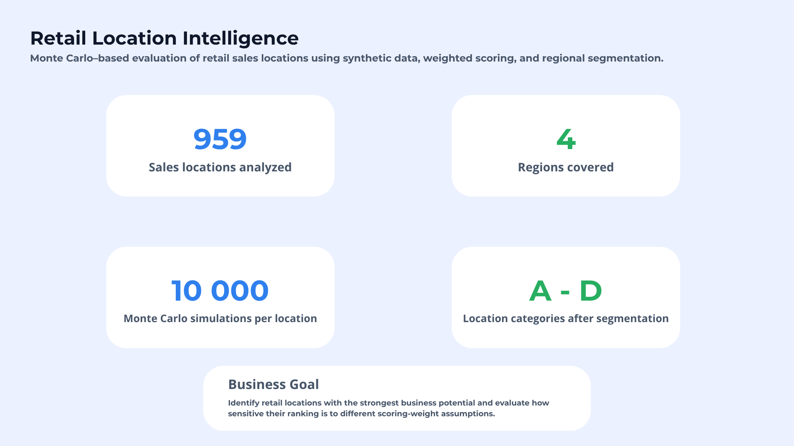
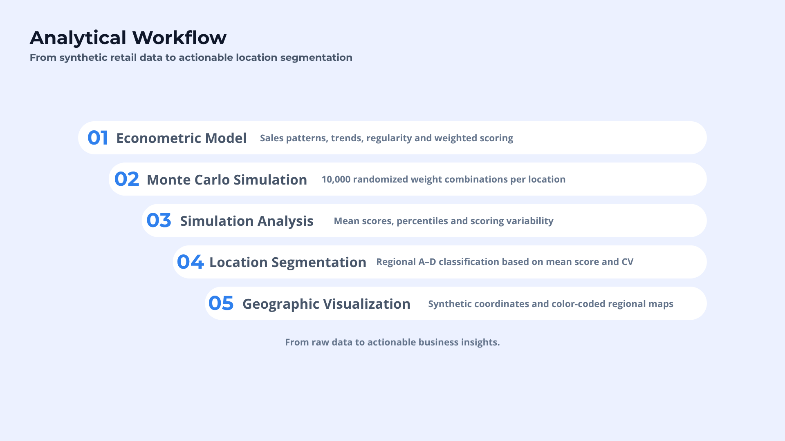
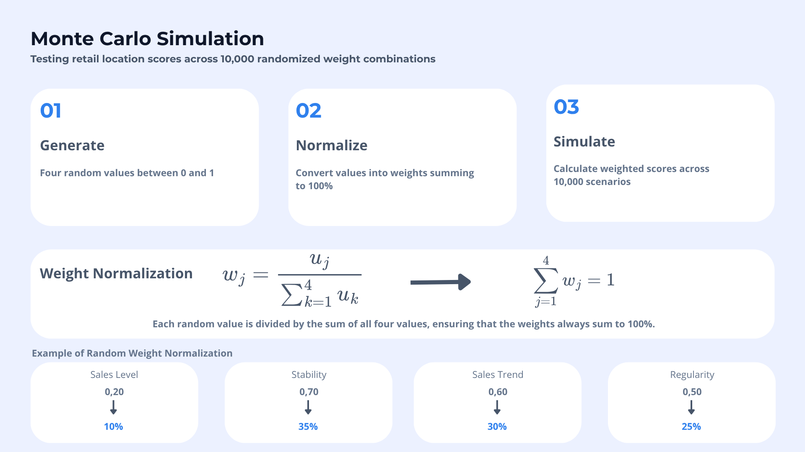
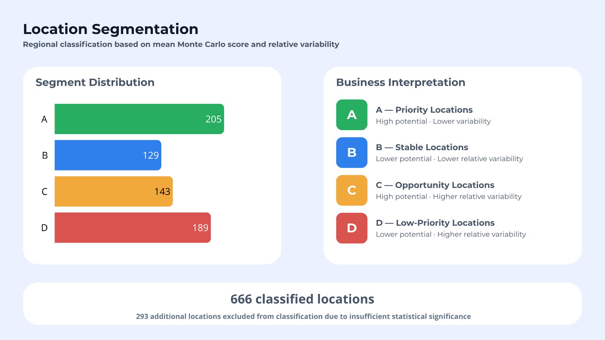
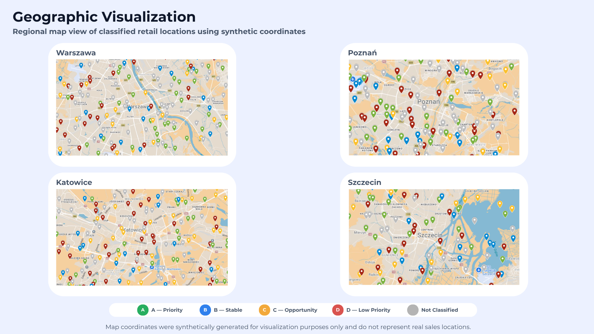

# Retail Location Intelligence — Symulacja Monte Carlo

**Wielokryterialny scoring punktów sprzedaży, analiza wrażliwości na dobór wag metodą Monte Carlo oraz segmentacja regionalna w Microsoft Excel.**

> **Projekt demonstracyjny do portfolio.** Opublikowane dane i współrzędne na mapach są syntetyczne. Współrzędne służą **wyłącznie do wizualizacji** i nie są zmiennymi wejściowymi modelu. Projekt jest przykładem wsparcia decyzji analitycznych, a **nie** zweryfikowaną prognozą sprzedaży ani rekomendacją inwestycyjną dla rzeczywistych lokalizacji.

**[English README](README.md)**



## Problem biznesowy

Jak wyznaczać priorytetowe punkty sprzedaży, jeżeli znaczenie przypisywane poziomowi sprzedaży, stabilności, trendowi i regularności jest subiektywne?

Zamiast uznawać jeden zestaw wag za obiektywnie prawidłowy, projekt bada, **jak ocena punktu zmienia się przy różnych kombinacjach wag**. Następnie wyniki symulacji są przekształcane w cztery czytelne kategorie regionalne.

## Projekt w liczbach

| Wskaźnik | Wartość |
|---|---:|
| Punkty sprzedaży w pełnej analizie | **959** |
| Regiony | **4** — Katowice, Poznań, Szczecin, Warszawa |
| Liczba scenariuszy Monte Carlo w pełnej analizie | **10 000 na punkt** |
| Punkty sklasyfikowane w grupach A–D | **666** |
| Punkty poza klasyfikacją A–D | **293** |
| Opublikowana demonstracja w Excelu | **20 punktów × 1 000 scenariuszy** |

**Pełna analiza** oraz **opublikowana wersja demonstracyjna** zawierają wyniki różnych uruchomień symulacji. Ponowne przeliczenie demonstracji nie odtworzy zatem wyników zapisanych w pliku 03.



## Etapy analizy i pliki

| Etap | Plik | Zawartość |
|---|---|---|
| **01 — Model punktowy** | [`01_Model_ekonometryczny.xlsx`](01_Model_ekonometryczny.xlsx) | Dane syntetyczne, analiza sprzedaży, obliczenia regresji liniowej, regularność, udziały w sprzedaży, oznaczenia istotności i scoring czterokryterialny. |
| **02 — Monte Carlo** | [`02_Symulacja_Monte_Carlo_GitHub.xlsx`](02_Symulacja_Monte_Carlo_GitHub.xlsx) | **Odchudzona demonstracja z formułami**: losowanie liczb, normalizacja wag i obliczenia scoringu dla 20 punktów oraz 1 000 scenariuszy. |
| **03 — Analiza wyników** | [`03_Analiza_wynikow_symulacji_GitHub.xlsx`](03_Analiza_wynikow_symulacji_GitHub.xlsx) | **Utrwalone wyniki pełnej analizy** (m.in. średnia, percentyle, miary zmienności). Miliony wyników pojedynczych symulacji nie są dołączone. |
| **04 — Segmentacja punktów** | [`04_Klasteryzacja_punktow.xlsx`](04_Klasteryzacja_punktow.xlsx) | Klasyfikacja regionalna A–D oparta na średnim scoringu i jego względnej zmienności oraz test progów decyzyjnych. |
| **05 — Dane do mapy** | [`05_Dane_do_wizualizacji.xlsx`](05_Dane_do_wizualizacji.xlsx) | Identyfikatory punktów, regiony, kategorie i syntetyczne współrzędne do Google My Maps. |

Arkusze w skoroszytach zachowują polskie nazwy. W tabeli zastosowano **docelowe nazwy plików w repozytorium** — przed przesłaniem należy usunąć dopiski wersji, np. `(1)` lub `(3)`.

## Metodologia

### 1. Wielokryterialny model scoringowy

Ocena kwalifikującego się punktu uwzględnia cztery kryteria:

- **Poziom sprzedaży**
- **Stabilność sprzedaży** (historyczna zmienność przekształcona tak, aby wyższa ocena oznaczała większą stabilność)
- **Trend sprzedaży**
- **Regularność sprzedaży**

Scoring punktu $i$ w scenariuszu $s$:

$$
S_{i,s}=\sum_{j=1}^{4}w_{j,s}x_{i,j}
$$

gdzie $x_{i,j}$ oznacza ocenę punktu według kryterium $j$, a $w_{j,s}$ wagę tego kryterium w scenariuszu. Kryteria mogą być współzależne, a konstrukcja stanowi przede wszystkim wielokryterialny model decyzyjny, nie przyczynowy model ekonometryczny.

Przykładowy sztywny zestaw wag wynosi **40% / 25% / 20% / 15%**. Nie jest przedstawiany jako empirycznie wyznaczony zestaw optymalny. Zadaniem Monte Carlo jest analiza konsekwencji innych dopuszczalnych wag.

### 2. Losowanie i normalizacja wag

Dla każdego scenariusza generowane są cztery wartości za pomocą funkcji `LOS()` (ang. `RAND()`):

$$
u_{j,s}\sim U(0,1),\qquad
w_{j,s}=\frac{u_{j,s}}{\sum_{k=1}^{4}u_{k,s}}
$$

Dzięki normalizacji $w_{j,s}\ge 0$ i $\sum_{j=1}^{4}w_{j,s}=1$. Ten sam zestaw wag jest wykorzystywany do oceny punktów w danym scenariuszu.

**Istotne ograniczenie:** normalizacja niezależnych losowań jednostajnych daje poprawne wagi sumujące się do 1, ale **nie** oznacza jednostajnego próbkowania całej przestrzeni możliwych kombinacji wag. Wyniki opisują wrażliwość w ramach **konkretnego mechanizmu losowania**, a nie obiektywnie najlepsze wagi. Inny rozkład wag (np. Dirichleta) może zmienić wyniki.



### 3. Statystyki wyników symulacji

Dla każdego punktu obliczono średnią scoringu, percentyle (w tym P10, P25, P50, P75, P90), odchylenie standardowe oraz szerokość przedziału P90–P10. **P90–P10 to rozstęp międzydecylowy, a nie klasyczny rozstęp maksimum minus minimum.**

Do oceny względnej wrażliwości scoringu na wagi wykorzystano:

$$
CV_{MC,i}=\frac{\sigma(S_{i,\cdot})}{\overline{S}_{i}}
$$

dla punktów z prawidłową dodatnią średnią. CV opisuje **zmienność scoringu wynikającą z losowania wag**, a nie historyczną niestabilność sprzedaży ani ryzyko prognozy. Historyczna stabilność sprzedaży jest odrębnym kryterium wejściowym.

### 4. Regionalna segmentacja A–D

Progi są wyznaczane **oddzielnie dla każdego regionu** na podstawie median średniego scoringu i median CV kwalifikujących się punktów. We wszystkich regionach obowiązują te same reguły decyzyjne.

| Grupa | Średni scoring | CV | Interpretacja biznesowa |
|---|---|---|---|
| **A** | Wysoki | Niski | Punkty priorytetowe: wysoka ocena i relatywnie niewielka wrażliwość na wagi |
| **B** | Niski | Niski | Punkty o niższym względnym potencjale i stabilniejszym scoringu |
| **C** | Wysoki | Wysoki | Punkty z potencjałem, ale bardziej zależne od doboru wag |
| **D** | Niski | Wysoki | Punkty o niższym priorytecie w ramach przyjętego modelu |

Określenia „wysoki” i „niski” odnoszą się do **progów danego regionu**, nie do jednolitych standardów bezwzględnych. Punkty oznaczone jako statystycznie niewystarczające pozostają **poza klasyfikacją**, a nie trafiają automatycznie do D. Jest to **segmentacja regułowa**, a nie klasteryzacja algorytmiczna, np. K-means.

Odporność klasyfikacji sprawdzono, porównując progi P45 i P55 z bazowym P50. Punkty bliskie granicom mogą zmieniać kategorię przy niewielkiej zmianie progów.



## Wyniki

| Region | A | B | C | D | Poza klasyfikacją | Razem |
|---|---:|---:|---:|---:|---:|---:|
| Katowice | 72 | 43 | 46 | 69 | 93 | 323 |
| Poznań | 54 | 27 | 36 | 44 | 71 | 232 |
| Szczecin | 29 | 19 | 21 | 26 | 29 | 124 |
| Warszawa | 50 | 40 | 40 | 50 | 100 | 280 |
| **Razem** | **205** | **129** | **143** | **189** | **293** | **959** |

Wśród **666 sklasyfikowanych punktów** udział kategorii wynosi około **30,8% A, 19,4% B, 21,5% C i 28,4% D**. Są to **wyniki projektu na danych syntetycznych**, nie dane o rzeczywistych sieciach sprzedaży.

## Wizualizacja geograficzna

Punkty przedstawiono w **Google My Maps** na podstawie syntetycznych par szerokości i długości geograficznej oraz kolorów kategorii. Mapa jest **warstwą prezentacyjną**: adresy, współrzędne, odległości ani inne cechy przestrzenne nie wpływają na scoring.



## Jak przeglądać projekt?

1. Pobierz pliki Excel z tabeli etapów i otwórz je w **Microsoft Excel**.
2. W etapie **01** sprawdź dane, kryteria i konstrukcję modelu punktowego.
3. W etapie **02** przejrzyj `Generator_wartości_losowych` oraz `Symulacja_Monte_Carlo`. Przeliczenie Excela (`F9`) powoduje ponowne losowanie i aktualizację znormalizowanych wag oraz scoringu demonstracyjnego.
4. W etapie **03** obejrzyj **zapisane statystyki pełnej analizy z 10 000 scenariuszy na punkt**; nie są one ponownie liczone na podstawie mniejszej demonstracji.
5. W etapie **04** przeanalizuj klasyfikacje regionalne i testy progów P45/P50/P55. Etap **05** zawiera dane syntetyczne do importu na mapę.

**Uwaga o odtwarzalności:** funkcja `LOS()` jest zmienna, a model nie zapisuje stałego ziarna generatora pseudolosowego. Kolejne przeliczenia mogą zatem dawać różne wyniki. Repozytorium zachowuje **logikę obliczeń**, a nie możliwość idealnego odtworzenia każdej wartości z pełnego uruchomienia. Surowe macierze milionów wyników pominięto w lekkiej wersji publikacyjnej.

## Ograniczenia i interpretacja wyników

- Wszystkie opublikowane rekordy są **syntetyczne**; nie ujawniają rzeczywistych adresów.
- Monte Carlo bada **wrażliwość oceny na wagi**, a nie prawdopodobieństwo przyszłych wyników sprzedaży.
- Normalizowane losowania jednostajne nie pokrywają jednostajnie wszystkich możliwych kombinacji wag.
- Progi są **regionalne, relatywne i przyjęte decyzyjnie**; identyczna litera nie oznacza identycznego poziomu bezwzględnej jakości między miastami.
- CV może być niestabilny lub nieokreślony przy średnim scoringu bliskim zeru; obserwacje niewystarczające lub nieprawidłowe są wyłączane z przydziału kategorii.
- Kategorie **nie były walidowane na przyszłej sprzedaży ani zwrocie z inwestycji**.
- Pliki 02 (demo) i 03 (wyniki pełnej analizy) nie przedstawiają tego samego uruchomienia symulacji.

## Narzędzia

**Microsoft Excel** (formuły, regresja liniowa, `LOS()`, symulacja, statystyki), **Google My Maps** (wyłącznie wizualizacja) i **Canva** (grafiki portfolio).

## Grafiki

Pięć grafik należy wyeksportować z Canvy jako PNG i umieścić w katalogu [`assets/`](assets/):

```text
assets/
├── 01_project_overview.png
├── 02_analytical_workflow.png
├── 03_monte_carlo_simulation.png
├── 04_location_segmentation.png
└── 05_geographic_visualization.png
```

**Kompetencje prezentowane w projekcie:** analiza wielokryterialna · Monte Carlo · analiza wrażliwości · modelowanie w Excelu · segmentacja biznesowa · wizualizacja danych.
